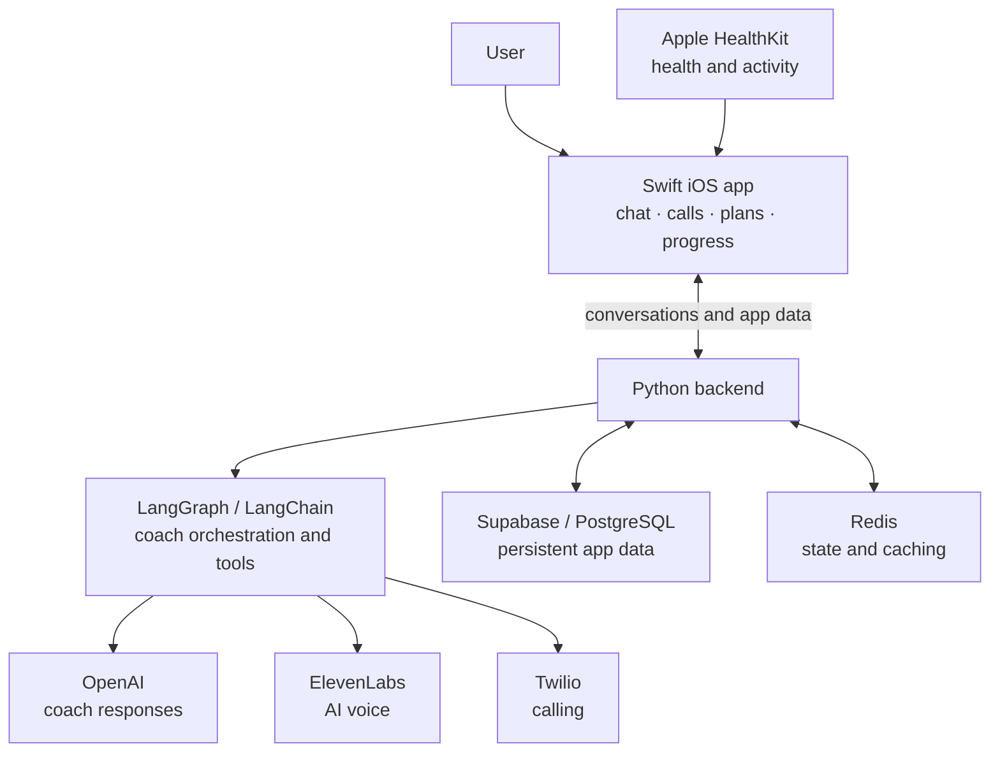

# Vaylo Fitness

Vaylo is an iOS fitness app built around personalized AI coaches. Users can choose a coach with a distinct personality and voice, then chat or call to adjust workouts, log activity and meals, and review progress. The aim is to make fitness guidance adapt to real life instead of requiring a perfect schedule.

> **Current status:** Vaylo was published on iOS and reached around 50 users. The app is temporarily offline while we secure funding for its operating costs and a wider launch. We plan to bring it back online soon. The links below show the product and recorded demos while the live coaching service is paused.

## What we built

- A Swift iOS app for onboarding, coach selection, chat, live calls, workout planning and logging, meals, and progress.
- Personalized AI coach personas with different coaching styles and a shared experience across text and voice.
- A Python backend using LangGraph and LangChain to manage conversation context and connect coaching tools to app data.
- Apple HealthKit integration for health and activity signals.
- Persistent application data in Supabase/PostgreSQL, with Redis for short-lived state and caching.
- Voice and calling integrations using ElevenLabs and Twilio.

## Architecture

The iOS client presents the coach and tracking experience. The backend coordinates AI interactions and connects them to workout and progress data. Voice and calling services support live conversations; the database and cache support the application state behind them. This is a high-level architecture overview of the product, not a source-code repository.

## Progress so far

- Published the iOS app and supported an initial group of around 50 users.
- Conducted user studies and gathered early feedback on the product experience.
- Built and demonstrated the chat, call, planning, logging, and progress flows.
- Began fundraising to restart the hosted services and support a broader launch.

## Explore Vaylo

- [Portfolio case study and feature demos](https://hibaa8.github.io/vaylo.html)
- [Official website](https://www.vaylofitness.com/)
- [App Store listing](https://apps.apple.com/us/app/vaylo-fitness/id6761638444)
- [Video demo](https://youtu.be/o6Z8BY7mJZ4)
